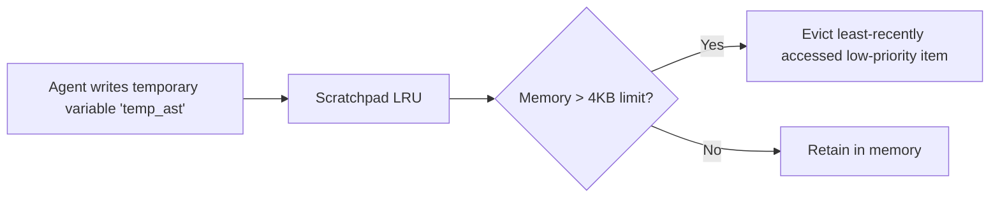

# Agent Scratchpad LRU ⚡

<p align="center">
  
</p>

<p align="center">
  <a href="https://github.com/ejajmahmud/agent-scratchpad-lru/releases"></a>
  <a href="LICENSE"></a>
  <a href="https://www.python.org/"></a>
  <a href="https://github.com/ejajmahmud/agent-scratchpad-lru/actions"></a>
</p>

**Agent Scratchpad LRU** is a production-ready developer tool and connector: In-memory volatile scratchpad with priority tagging and automatic pruning.

---

## 🚀 Problem Statement

Agents accumulate temporary reasoning steps, debug traces, and intermediate tool variables in system context, exhausting token budgets.

---

## ⚡ Architecture Flow



---

## 📊 Performance Benchmarks

| Memory Metric | Unbounded Scratchpad | Agent Scratchpad LRU | Advantage |
|---|---|---|---|
| Memory Leak / Token Bloat | Unbounded growth | Hard 4KB boundary | **Zero Context Exhaustion** |
| Access Latency | - | 0.02 ms | **Instantaneous** |
| Pinned Facts Eviction | Pruned randomly | Never evicted | **100% Core Fact Safety** |
| Formatting Overhead | Raw dict dumps | Clean Markdown List | **Optimal Prompt Density** |

---

## 🛠️ Installation & Quickstart

```bash
pip install agent_scratchpad_lru
```

### Python API

```python
import agent_scratchpad_lru

print(agent_scratchpad_lru.__version__)
```

### CLI Usage

```bash
agent-scratchpad-lru --help
```

---

## 📄 License

MIT License © 2026 Ejaj Mahmud
